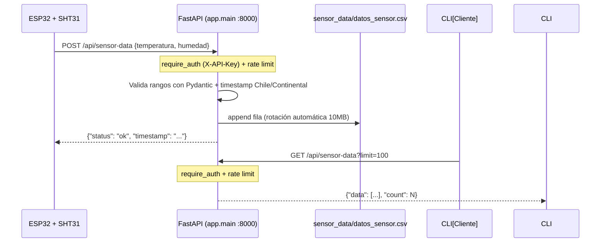

# hyt-monitor

Sistema de monitoreo de temperatura y humedad: un ESP32 con sensor SHT31 lee datos ambientales y los envía a un servidor FastAPI vía HTTP POST. El servidor guarda en un CSV rotativo y expone endpoints REST para ingesta y consulta.

[](https://python.org)
[](https://fastapi.tiangolo.com/)
[](https://www.arduino.cc/)
[](https://www.docker.com/)
[](https://github.com/bi0punk/hyt-monitor/actions)
[](LICENSE)

## Contenido

- [Características](#características)
- [Arquitectura](#arquitectura)
- [Stack](#stack)
- [Estructura del repositorio](#estructura-del-repositorio)
- [Instalación](#instalación)
- [Uso](#uso)
- [Configuración](#configuración)
- [Datos](#datos)
- [Seguridad](#seguridad)
- [Tests / CI](#tests--ci)
- [Licencia](#licencia)

## Características

- Firmware ESP32 (SHT31) que POSTea lecturas a un servidor FastAPI
- Validación de rangos con Pydantic (temperatura -50..100 °C, humedad 0..100 %)
- Persistencia en CSV con rotación automática a los 10 MB
- Timestamp en zona horaria `Chile/Continental`
- Despliegue con Docker + volumen persistente para `sensor_data/`
- Autenticación vía API Key en todos los endpoints
- Rate limiting configurable por IP
- Endpoint GET para consulta de datos históricos
- Protección contra race condition en rotación CSV (`threading.Lock`)

## Arquitectura



Flujo: el ESP32 lee temperatura/humedad del SHT31 y hace `POST /api/sensor-data`; el servidor valida con Pydantic, timestampa y appenda al CSV con rotación a 10 MB, protegido por API Key y rate limit.

## Stack

| Componente | Tecnología |
|---|---|
| Servidor | Python 3.12+, FastAPI + Uvicorn |
| Sensor | SHT31 (I2C) vía firmware `sht.ino` (C++/Arduino) |
| Persistencia | CSV rotante |
| TZ | pytz (`Chile/Continental`) |
| Calidad | ruff (lint), pytest |
| Despliegue | Docker + Docker Compose |

## Estructura del repositorio

```
hyt-monitor/
├── app/
│   └── main.py             # Aplicación FastAPI (POST/GET + CSV rotativo)
├── sht.ino                 # Firmware ESP32 + SHT31
├── credentials.example.h   # Template WiFi/URL (copia a credentials.h)
├── sensor_data/            # Datos persistidos (gitignored)
├── tests/
├── Dockerfile
├── docker-compose.yml
├── requirements.txt
├── pyproject.toml
├── .env.example
├── .github/workflows/ci.yml
└── README.md
```

## Instalación

Requisitos: Python 3.12+ (o Docker), ESP32 + sensor SHT31 para el firmware (opcional para solo servidor), conexión WiFi entre ESP32 y el host del servidor.

Con Docker (recomendado):

```bash
docker compose up -d --build
```

Sin Docker:

```bash
python3 -m venv .venv
source .venv/bin/activate
pip install -r requirements.txt
uvicorn app.main:app --host 0.0.0.0 --port 8000
```

### Firmware ESP32

1. Copia `credentials.example.h` a `credentials.h`
2. Edita `credentials.h` con tu SSID, password WiFi y URL del servidor
3. Flashea `sht.ino` al ESP32 con Arduino IDE

`credentials.h` está en `.gitignore` y no se sube al repositorio.

## Uso

### POST — Enviar datos del sensor

```bash
curl -X POST http://localhost:8000/api/sensor-data \
  -H 'Content-Type: application/json' \
  -H 'X-API-Key: tu_api_key' \
  -d '{"temperatura": 22.5, "humedad": 60.0}'
```

Respuesta:

```json
{"status": "ok", "timestamp": "2026-07-02T...-04:00"}
```

### GET — Consultar datos

```bash
curl -H 'X-API-Key: tu_api_key' http://localhost:8000/api/sensor-data?limit=100
```

## Configuración

Variables de entorno:

| Variable | Default | Descripción |
|---|---|---|
| `HYT_API_KEY` | (vacío) | API Key para autenticación. Si no se define, se deshabilita la auth |
| `HYT_CSV_FILE` | `/app/sensor_data/datos_sensor.csv` | Ruta del CSV |
| `HYT_RATE_LIMIT` | `60` | Peticiones máximas por minuto por IP |

## Datos

- `sensor_data/datos_sensor.csv` — datos persistidos (cabecera: `timestamp,temperatura,humedad`). Rotación a los 10 MB con sufijo timestamp. Gitignored.

## Seguridad

- Autenticación por API Key configurable (`X-API-Key` header)
- Rate limiting (60 req/min por IP por defecto)
- `credentials.h` con datos WiFi del ESP32 está en `.gitignore`
- `credentials.example.h` contiene la plantilla documentada
- Para producción: usar tras reverse proxy con HTTPS

## Tests / CI

CI: GitHub Actions sobre Python 3.12:

- **lint** — `ruff check .`
- **test** — pytest

```bash
pytest -q
```

## Licencia

MIT — ver [LICENSE](LICENSE).